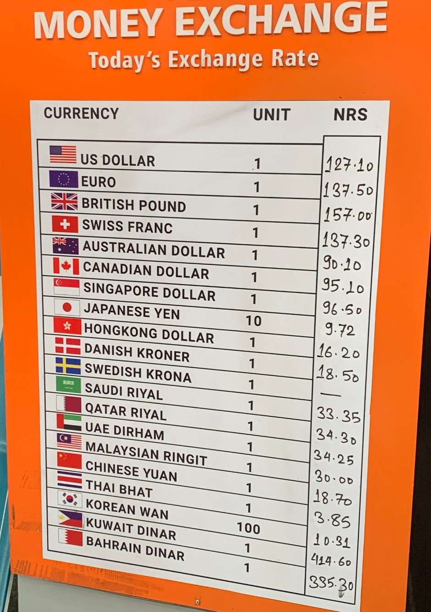
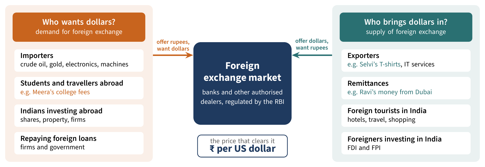
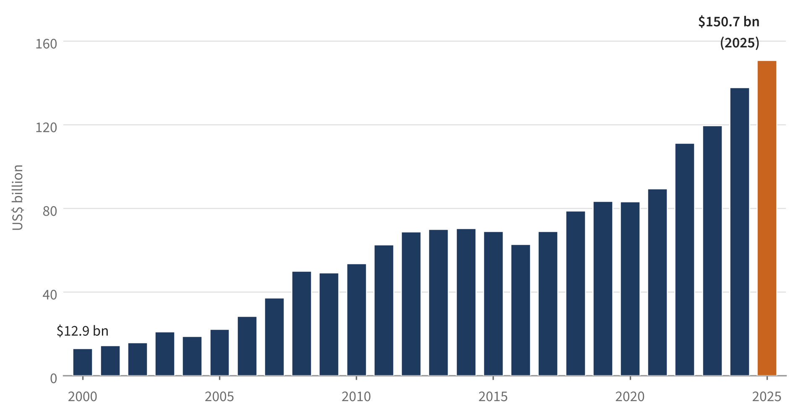

# The Foreign Exchange Rate

*Member 1: Introduction, Section 1, Section 2, Section A and Conclusion*

## Introduction: Meera’s dollar problem

In October 2026, Meera, a Class 12 student in Chennai, got the email her family had been waiting for: a college in the United States had offered her a place. The first-year fees were US$40,000, exactly what the college had charged a year earlier. Yet when her father asked his bank what the fees would cost in rupees, the answer was about ₹2.5 lakh more than it would have been a year before. The college had not raised its price. The price of the dollar had gone up.

> Note: The fees are hypothetical. The exchange rates are real closing rates: ₹88.67 per US dollar on 13 October 2025 (Business Standard, 2025) and ₹95.05 on 15 October 2026 (HDFC Sky, 2026). 40,000 × (95.05 − 88.67) = ₹2,55,200.

Meera’s uncle Ravi, an electrician in Dubai, had the opposite surprise. Every month he sends part of his salary home to his parents in Thanjavur. This year the same amount arrived as more rupees than before.

One family, one price, and two very different outcomes. This chapter explains what that price is, who sets it, and why it keeps moving.

> **Key points: Questions this chapter answers**
> - Why does one country’s money have a price in another country’s money?
> - Who buys and sells currencies, and why?
> - What decides that price, and why does it change so often?
> - How do countries, and the Reserve Bank of India, manage their exchange rates?
> - Who gains and who loses when the rupee rises or falls?

## 1 What is an exchange rate?

Chai in Chennai is paid for in rupees, but coffee in New York needs US dollars and a meal in Dubai needs dirhams. So whenever goods, services or savings cross a border, one currency has to be swapped for another. The price of that swap is the **exchange rate**: the price of one currency in terms of another (National Council of Educational Research and Training [NCERT], 2007). In India it is set mainly by buyers and sellers in a market, and like the price of onions it can change from minute to minute.

Indian banks write the rate as a **direct quote**, “US$1 = ₹95”, which is the number of rupees needed to buy one dollar (Jayadev, 2021). Flip it and you get the **indirect quote**, “₹1 = US$0.0105”, which is the number of dollars one rupee buys. This chapter always uses the direct quote, rupees per dollar (₹/$), so a bigger number means a weaker rupee. At ₹95 instead of ₹88, every rupee buys fewer dollars [see: Appreciation and depreciation: who wins, who loses?].

**Figure M1-1.** A money exchange board at Kathmandu airport, January 2023.
Each row is a direct quote: the price of one unit of a foreign currency in Nepalese rupees (NRs). A US dollar costs NRs 127.10 and a UAE dirham, the currency Ravi earns, about NRs 34. The Japanese yen is priced per 10 yen, because a single yen is worth very little.
*Source:* Photograph by Chainwit. (2023), Wikimedia Commons, CC BY 4.0, cropped.

> **Did you know? Every board hides two prices**
> Banks and money changers quote two rates for each currency: a lower rate at which they buy it from you and a higher rate at which they sell it to you. Suppose a bank buys dollars at ₹93.50 and sells them at ₹96.50. Change ₹10,000 into dollars and you get US$103.63. Change them straight back and you get only ₹9,689. The missing ₹311 is the bank’s earning, called the **spread**. Spreads are usually widest for cash at airport counters, which is why travellers lose the most there.
> *The rates in this example are hypothetical.*

### Why everyone watches the dollar

Why does the news talk only about the rupee’s price in dollars? Because the dollar is the world’s working currency. In April 2025 it was on one side of 89 per cent of all currency trades (Bank for International Settlements [BIS], 2025). Crude oil, India’s biggest import, is priced in dollars, and only about 6 per cent of India’s exports are invoiced in rupees (Reserve Bank of India [RBI], 2026a). Since July 2022 the RBI has allowed Indian firms to settle foreign trade in rupees (RBI, 2022), but most still choose the dollar, because almost everyone, everywhere, will accept it.

The dollar even reaches currencies that seem unrelated. The UAE dirham, which Ravi earns, has been fixed at 3.6725 dirhams per US dollar since 1997 (Nagraj, 2024). So when a dollar costs more rupees, so does a dirham, and every dirham Ravi sends home turns into more rupees.

## 2 The foreign exchange market: who needs dollars and who supplies them?

Currencies are bought and sold in the **foreign exchange market**, or forex market. It has no building and no closing bell. It is a worldwide network of banks, dealers and large firms that trade with each other electronically, and as the day moves from Tokyo and Singapore to Mumbai, London and New York, the trading moves with it (Greenlaw et al., 2022).

Figure M1-2 sorts the people in this market into two groups. Importers, students and travellers abroad, Indians investing abroad and anyone repaying a foreign loan need dollars. Together they make up the **demand for foreign exchange**. Exporters like Selvi, whose garment unit in Tiruppur sells T-shirts to American shops, workers abroad like Ravi who send home **remittances**, foreign tourists and foreign investors all bring dollars in. They make up the **supply of foreign exchange** (NCERT, 2007). Every deal is two purchases at once: when Meera’s father buys dollars, he is also selling rupees (Greenlaw et al., 2022). The exchange rate is the price at which the two sides match [see: How the exchange rate is determined: demand and supply].

**Figure M1-2.** Who wants dollars and who brings them in.
Each group on the left offers rupees to get dollars. Each group on the right offers dollars to get rupees.
*Source:* Drawn by the authors, based on NCERT (2007, Chapter 6) and Greenlaw et al. (2022, Section 29.1).

### Most currency trading is not about trade

In April 2025, about US$9.6 trillion worth of currencies changed hands every day (BIS, 2025). All the world’s exports of goods and services in 2024 were worth about 33 trillion dollars (United Nations Conference on Trade and Development [UNCTAD], 2025). So the forex market trades a whole year of world exports in less than four days. Most of this trading is done by banks and investors moving savings between countries.

Investors come in two kinds. **Foreign direct investment (FDI)** buys a lasting stake in a business, like a carmaker building a factory near Chennai, and it stays for years. **Foreign portfolio investment (FPI)** buys shares and bonds, and it can leave in a single day (Greenlaw et al., 2022). That is why its comings and goings can jolt the rupee [see: What moves the rupee?].

To buy dollars for the fees, Meera’s father will simply walk into his bank in Chennai. Under the Foreign Exchange Management Act, 1999, only banks and firms licensed by the RBI, such as **authorised dealers** and money changers, may deal in foreign currency. They trade with customers, with each other and with banks abroad, while the RBI makes the rules and, at times, buys or sells dollars itself [see: The RBI and India’s foreign exchange reserves].

> **Case study: Selvi’s three-month gamble**
> In October, Selvi agrees to sell T-shirts worth US$20,000 to a shop in New York, which will pay in January. At today’s rate of ₹95, that is ₹19 lakh. But if the rupee strengthens to ₹90 by January, she will receive only ₹18 lakh, and her profit could vanish. To avoid the gamble, Selvi can sign a **forward contract** with her bank today, fixing the rate at which the bank will buy her dollars in January. The rate for a deal settled today is the **spot rate**. A rate agreed today for a deal in the future is a **forward rate**. Importers use the same tool to protect themselves from a weaker rupee.
> *The figures in this example are hypothetical.*

> **How economists learn from facts: Ravi is one of millions**
>
> 
>
> **Figure M1-3.** Remittances received by India, 2000–2025 (US$ billion).
> *Source:* World Bank (2026), World Development Indicators, series BX.TRF.PWKR.CD.DT.
>
> In 2025, Indians working abroad sent home US$150.7 billion, more than any other country received and more than twice as much as Mexico, the next-largest recipient (World Bank, 2026). Where the money comes from is changing. In 2020-21 the US sent 23.4 per cent of it and the UAE 18.0 per cent. By 2023-24 the US share had risen to 27.7 per cent, while the UAE’s had barely moved, to 19.2 per cent. An RBI study links this to more skilled Indians working in advanced economies (Gajbhiye et al., 2025).
>
> **Read the chart.** (a) Roughly how many times larger were remittances in 2025 than in 2000? (b) In which year did they fall most sharply, and what might explain it?
>
> *Answers.* (a) About 12 times (150.7 ÷ 12.9 ≈ 11.7). (b) 2016, when they fell about 9 per cent. The World Bank linked the fall to low oil prices and government spending cuts in the Gulf countries, where many Indians work (World Bank, 2017).

> **Exercise: Dollars in or dollars out?**
> For each transaction, decide whether it adds to India’s demand for dollars or to the supply of dollars.
> (a) Meera’s father pays her first-year fees.
> (b) Ravi sends 3,000 dirhams to his parents in Thanjavur.
> (c) A shop in New York pays Selvi for 5,000 T-shirts.
> (d) A Japanese carmaker builds a new factory in Tamil Nadu.
> (e) An Indian oil company buys a shipload of crude oil.
> (f) An American investor sells her Indian shares and takes the money home.
> (g) A family from Germany spends a week on a Kerala houseboat.
> *Answers.* Supply: (b), (c), (d), (g). Demand: (a), (e), (f).

> **Did you know? Watch and learn**
> Khan Academy’s *KA Macroeconomics Class 12* course, which follows the NCERT syllabus, has a short video on how currency exchange works: [Currency exchange introduction](https://www.khanacademy.org/economics-finance-domain/class-12-macroeconomics/x29cdf3f0a895464f:open-economy-macroeconomics/x29cdf3f0a895464f:foreign-exchange-market/v/currency-exchange-introduction).

## A The rupee’s account book: the balance of payments

Every dollar that enters or leaves India is written down in the **balance of payments (BoP)**, the record of all economic transactions between the residents of a country and the rest of the world over a period such as a year (NCERT, 2007). The **current account** records trade in goods and services, along with income and transfers such as remittances. The **capital account** records the buying and selling of assets, such as FDI, FPI and foreign loans. When a country spends more foreign currency on its current account than it earns, it runs a **current account deficit (CAD)**. The gap must then be paid for by a net inflow on the capital account or by drawing down the country’s reserves (NCERT, 2007).

India imports far more goods than it exports, mainly oil, gold and electronics. But software exports and remittances earn so much that they cover most of the gap. In 2025-26 these and other **invisibles** (services, income and transfers) brought in a net US$312 billion, leaving a current account deficit of only US$25.2 billion, about 0.6 per cent of GDP (RBI, 2026b). The capital account could not fill even this gap, because foreign portfolio investors took out a net US$16.4 billion. So the RBI drew about US$23.6 billion from its reserves [see: The RBI and India’s foreign exchange reserves].

## Conclusion

Now look again at Meera’s fees. In 2026, dearer oil raised India’s demand for dollars, while foreign investors selling Indian assets cut the supply [see: What moves the rupee?]. The RBI sold dollars from its reserves to slow the rupee’s fall but did not stop it, and the bill for her fees went up by ₹2.5 lakh. The same move gave Ravi’s family more rupees for every dirham. An exchange rate is just a price, but so much of India’s trade, savings and borrowing passes through it that this one price reaches almost every household in the country.

## References

Bank for International Settlements. (2025, September 30). *Global FX trading hits $9.6 trillion per day in April 2025 and OTC interest rate derivatives surge 79%* [Press release]. https://www.bis.org/media-releases/20250930-global-fx-trading-hits-96-trillion-day-april-2025-and-otc-interest-rate-derivatives-surge-79

Business Standard. (2025, October 13). *Rupee recovers from day’s low even as oil prices advance, ends at 88.67/$*. https://www.business-standard.com/markets/news/rupee-recovers-from-days-low-even-as-oil-prices-advance-ends-at-88-67-per-dollar-125101300727_1.html

Chainwit. (2023). *Arrival at Kathmandu Tribhuvan Airport (01-2023) - img 06* [Photograph]. Wikimedia Commons. CC BY 4.0. https://commons.wikimedia.org/wiki/File:Arrival_at_Kathmandu_Tribhuvan_Airport_(01-2023)_-_img_06.jpg

Gajbhiye, D., Kundu, S., George, A., Vinherkar, O., Anees, Y., & Baby, J. (2025, March 19). Changing dynamics of India’s remittances: Insights from the sixth round of India’s Remittances Survey. *RBI Bulletin*. https://www.rbi.org.in/Scripts/BS_ViewBulletin.aspx?Id=23260

Greenlaw, S. A., Shapiro, D., & MacDonald, D. (2022). *Principles of economics* (3rd ed.). OpenStax. https://openstax.org/books/principles-economics-3e/pages/29-1-how-the-foreign-exchange-market-works

HDFC Sky. (2026, October 15). *Rupee rises for 5th session, closes at 95.05 on RBI support*. https://hdfcsky.com/news/inr-vs-usd-rate-october-15-2026

Jayadev, A. (2021). *The economy: A South Asian perspective* (Version 1.0.1). CORE Econ. https://books.core-econ.org/the-economy-south-asia/

Khan Academy. (n.d.). *Currency exchange introduction* [Video]. KA Macroeconomics Class 12. https://www.khanacademy.org/economics-finance-domain/class-12-macroeconomics/x29cdf3f0a895464f:open-economy-macroeconomics/x29cdf3f0a895464f:foreign-exchange-market/v/currency-exchange-introduction

Nagraj, A. (2024, November 22). Timeframe: When the UAE pegged its dirham to the US dollar in 1997. *The National*. https://www.thenationalnews.com/lifestyle/2024/11/22/uae-dirham-dollar-peg/

National Council of Educational Research and Training. (2007). *Introductory macroeconomics: Textbook in economics for Class XII*. NCERT. https://ncert.nic.in/textbook/pdf/leec106.pdf

Reserve Bank of India. (2022, July 11). *International trade settlement in Indian rupees (INR)* (A.P. (DIR Series) Circular No. 10). https://rbi.org.in/Scripts/NotificationUser.aspx?Id=12358

Reserve Bank of India. (2026a, January 21). Invoicing in INR of exports of goods and software and imports of goods. *RBI Bulletin*, Table 39(a). https://www.rbi.org.in/Scripts/BS_ViewBulletin.aspx?Id=23953

Reserve Bank of India. (2026b, June 8). *Developments in India’s balance of payments during the fourth quarter (January–March) of 2025-26* [Press release]. https://www.rbi.org.in

United Nations Conference on Trade and Development. (2025, March 14). *Global trade update (March 2025)*. https://unctad.org/news/global-trade-hits-record-33-trillion-2024-driven-services-and-developed-economies

World Bank. (2017, April 21). *Remittances to developing countries decline for second consecutive year* [Press release]. https://www.worldbank.org/en/news/press-release/2017/04/21/remittances-to-developing-countries-decline-for-second-consecutive-year

World Bank. (2026). *Personal remittances, received (current US$)* [Data set]. World Development Indicators. Retrieved October 16, 2026, from https://data.worldbank.org/indicator/BX.TRF.PWKR.CD.DT
